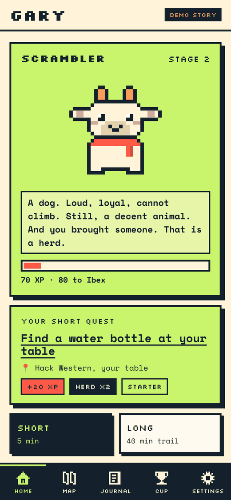
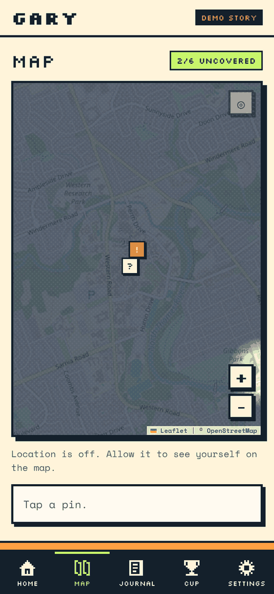
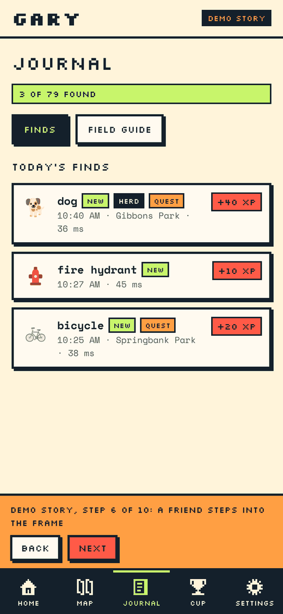
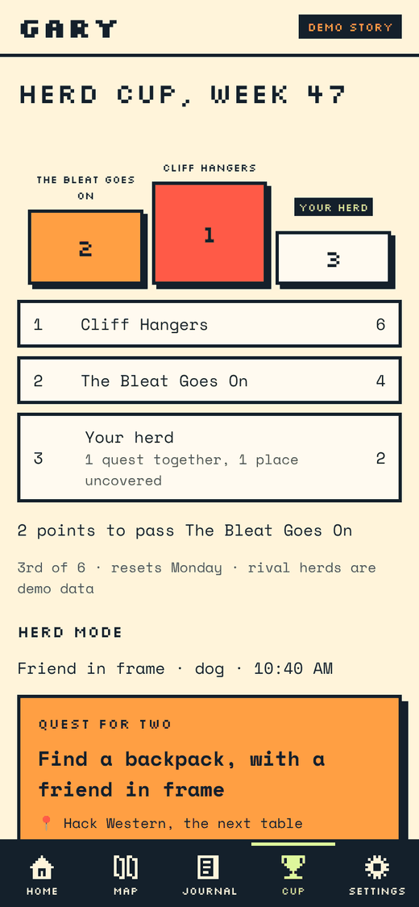

# Gary the Goat

A pocket mountain goat on a QNX handheld that only grows when you go outside,
discover new places and bring a friend. Built at Hack Western 13.

**Other apps count your steps. Gary counts your stories.**

Devpost: [link] · Demo video: [link] · TinyFish post: [link]

<p>
  
  
  
  
</p>

The web page in its demo story mode.

## What it does

1. **A scout finds quests.** A TinyFish web agent reads live London, Ontario
   pages (city parks, trails, the events calendar) and comes back with real
   places. Each becomes a quest: "Find a bench at Harris Park."
2. **You pick short or long.** That is the only choice.
3. **The Sniff Test.** Point Gary at something and press his button. A model
   on the device names what the camera sees. No photo is stored or sent, only
   the word.
4. **Gary reacts.** The find goes into his journal with a line in his voice.
   The quest's place loses its fog on the map, his field guide fills in, and
   he earns XP and grows.
5. **Herd Mode.** With a friend in the frame a sniff counts double, quests for
   two complete, and your herd climbs the weekly Herd Cup. Herds are ranked.
   People never are.
6. **A private check-in.** Before and after an outing you can tap how you
   feel. It never appears in Gary's world or the herd, the page can be locked
   with a passphrase, and it never claims the walk caused anything.

Gary never punishes. There are no streaks. After a quiet spell he naps.

## How it works

```
 Pi 5 on QNX                              Vultr                            Browser
 ┌───────────────────────────┐          ┌────────────────────────┐      ┌───────────────────┐
 │ gary      camera → model   │ events   │ API + rules            │ state│ React + SVG Gary  │
 │   ▲ button                 │ ───────► │ XP, stages, fog, herd  │ ───► │ map, journal,     │
 │   ▼ journal                │ ◄─────── │ private mood store     │      │ quest, wellness   │
 │ sync      upload / fetch   │  quests  │ Postgres on Tiger Data │      └───────────────────┘
 │ gary_io   button, buzzer   │          └───────────▲────────────┘
 └───────────────────────────┘                       │ quests
                                          scout: a TinyFish agent on live sites
```

The device records facts. The backend owns every rule. The page draws. The
scout writes quests. The four meet only at a small written contract of JSON
shapes.

| Folder | What |
| --- | --- |
| [`device/`](device/README.md) | Gary himself: camera, on-device model, the Sniff Test, button and buzzer. C++ for QNX, Python for laptops |
| [`backend/`](backend/README.md) | The API and every rule: XP, stages, the map, the herd, the private check-ins |
| [`web/`](web/README.md) | The page that draws Gary's world |
| [`scout/`](scout/README.md) | The TinyFish agent that turns live local pages into quests |
| [`contract/`](contract/README.md) | The JSON shapes the four share |
| [`docs/`](docs/) | The plan, the runbook, the demo script, the Devpost draft |

## Try it in two minutes, with no hardware

The demo story, with nothing else running:

```
cd web && npm install && npm run dev        # open the address it prints, press Next
```

The real thing, on one laptop:

```
cd backend && pip install -r requirements.txt && uvicorn app:app --port 8000     # terminal 1
cd web && npm install && VITE_API_URL=http://localhost:8000 npm run dev          # terminal 2
python3 device/fake_sniff.py backpack --friend                                    # terminal 3: watch the page
```

Everything, checked: `sh scripts/check_all.sh`.

## What is real and what is demo data

- **Real:** the Sniff Test (a model on the device, on a live camera), and XP,
  stages, the map, the journal, the field guide, Herd Mode and the check-ins,
  all computed by the backend from the device's events. Quests marked "Found
  by the scout" come from a live TinyFish run; `scout/EVIDENCE.md` lists the runs.
- **Demo data, and labelled on the page:** the rival herds in the Herd Cup, the
  sample week in the wellness view, the demo story, and the built-in table
  quests.
- **Limits:** Gary recognises 79 everyday things. He has no GPS, so the Sniff
  Test proves the thing and the quest's place is taken on trust. There is one
  Gary and there are no accounts: the wellness view in Settings opens with one
  passphrase, set on the server.

## What has run where

Update this table as each row is done.

| Part | On a laptop | On the real thing |
| --- | --- | --- |
| The Sniff Test, C++ for QNX | Built and tested on Linux with stand-ins for QNX's camera | [not yet: issue #4] |
| Button and buzzer | Tested with stand-in pins | [not yet: issues #10, #11] |
| Backend | Tested in memory and on PostgreSQL 16 | [not yet on Tiger Data or Vultr: issues #16, #22] |
| Web page | Tested, and looked at in Chrome at phone and desktop sizes | [not yet on a real phone] |
| Scout | Tested against a stand-in for TinyFish | [no live run yet: issue #8] |

## For the team

- **[CONTEXT.md](CONTEXT.md)**: what is built, what is not, how to run and test it, and the rules for changing it. Coding agents read this first.
- **[docs/RUNBOOK.md](docs/RUNBOOK.md)**: from now to the submission, in order.
- **[docs/DEMO.md](docs/DEMO.md)**: the three-minute demo. `python3 scripts/demo.py check` says whether it is ready.
- **[docs/DEVPOST.md](docs/DEVPOST.md)** and **[docs/TINYFISH_POST.md](docs/TINYFISH_POST.md)**: drafts.
- **[docs/PLAN.md](docs/PLAN.md)**: the plan and the phases.

## Credits

- Object detector, label list and test photos: [google-coral/test_data](https://github.com/google-coral/test_data) (Apache-2.0).
- Camera wrapper and build recipe on QNX: [qnx/QNX-AI-workshop](https://github.com/qnx/QNX-AI-workshop) (Apache-2.0).
- Typefaces: Silkscreen and Space Mono (SIL Open Font License), through Fontsource.
- Map: [Leaflet](https://leafletjs.com) (BSD 2-Clause), with street tiles and data from [OpenStreetMap](https://www.openstreetmap.org/copyright) contributors.
- [How the team used AI coding tools.]
